# P3L6: Virtualization

## 1. Preview

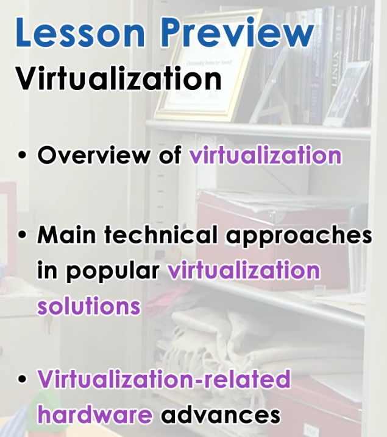

This lesson preview introduces the core topics and reference materials for System Virtualization, summarized into four key points:

- **Core Topic & Role:** Explains what system virtualization is and why it is critical for managing physical resources within the system software stack.

- **Key Virtualization Technologies:** Examines the core technical approaches behind popular virtualization solutions, including Xen, KVM, and VMware ESX .

- **Hardware Advances (x86 Architecture):** Covers major hardware developments over the past decade driven by virtualization trends, specifically within the context of the x86 architecture.

Reference Material: Much of the lecture draws from Rosenblum and Garfinkel's classic 2005 paper, Virtual Machine Monitors: Current Technologies and Future Trends. While the field has evolved significantly since 2005, the paper remains a useful foundational reference.

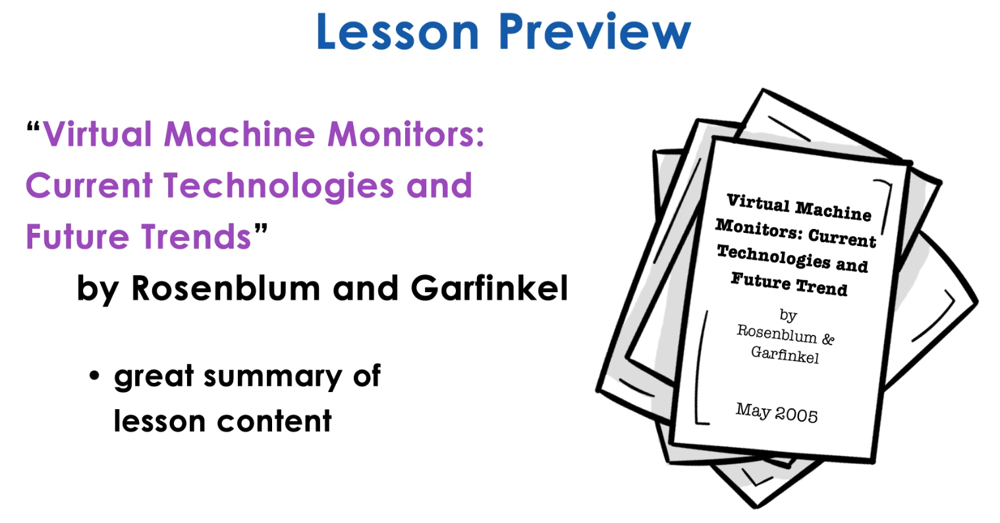

Reference: Rosenblum and Garfinkel "*Virtual Machine Monitors: Current Technologies and Future Trends*" (2005).

## 2. What Is Virtualization?

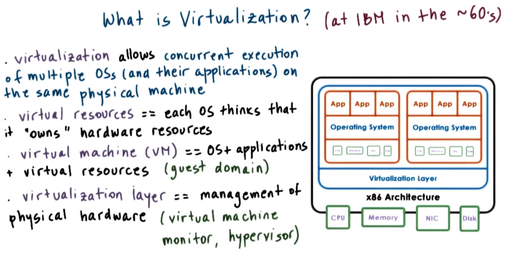

This section introduces the origin, core concept, and basic architecture of **Virtualization**, summarized into four key points:

* **Historical Origin:** Virtualization originated in the 1960s at IBM. At the time, computing relied on a few large mainframes shared by many users and business services. To run diverse workloads concurrently on the same hardware without forcing everything onto a single operating system, a model was needed to deploy multiple OSs simultaneously on one physical platform.
* **Core Concept (Hardware Illusion):** With virtualization, each operating system running on the shared physical platform operates under the illusion that it directly owns the underlying hardware resources—or at least a dedicated subset of them (e.g., believing it owns a smaller portion of the machine's actual physical memory).
* **Virtual Machine (VM) & Terminology:** An operating system, its applications, and the virtual resources it perceives together form a **Virtual Machine (VM)**, distinguishing it from the natively managed physical machine. VMs are commonly referred to as **guests** (e.g., *guest VMs*) or **domains** (e.g., *guest domains*).
* **The Virtualization Layer (VMM / Hypervisor):** Supporting multiple coexisting VMs requires an underlying software layer to allocate and manage real physical hardware resources while enforcing **isolation guarantees** across VMs. This layer is called a **Virtual Machine Monitor (VMM)** or **Hypervisor**, which can be designed and implemented using various technical approaches.

## 3. Defining Virtualization

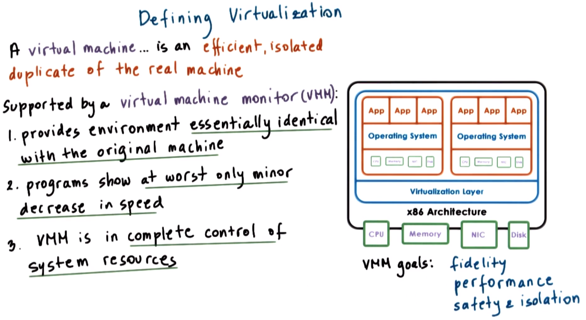

This section covers the formal definition of **Virtualization** and the **three essential characteristics of a Virtual Machine Monitor (VMM)** based on Popek and Goldberg's classic 1974 paper :

* **Formal Definition:** A virtual machine is defined as an **efficient, isolated duplicate of the real machine**, enabled and managed by a **Virtual Machine Monitor (VMM)**.
* **Characteristic 1 — Equivalence / Fidelity:** The VMM provides a program environment essentially identical to the original machine—matching CPU architecture and device types—even if resource capacities differ (e.g., fewer CPUs or less memory), ensuring fidelity between virtualized hardware and the physical platform.
* **Characteristic 2 — Efficiency / Near-Native Performance:** Programs running in the virtualized environment experience at most a minor slowdown; if allocated equivalent resources to the physical machine, the guest OS and its processes should perform as close to native speed as possible.
* **Characteristic 3 — Complete Resource Control & Isolation:** The VMM retains full control over system resources—deciding which VM accesses what resource and when. Rather than inspecting every single hardware access, the VMM governs direct hardware access permissions and prevents a VM from altering resource policies to harm co-located VMs, guaranteeing safety and isolation.

Reference: Popek and Goldberg "*Formal Requirements for Virtualizable Third Generation Architectures*" (1974)

## 4. Virtualization Technologies Quiz and Answers

Based on the classical definition of **virtualization** by Popek and Goldberg (1974), which of the following can be considered **virtualization technologies**? (Select all that apply.)
  * VirtualBox
    * `APPLIES`
  * Java Virtual Machine (JVM0)
    * `DOES NOT APPLY`
  * Virtual GameBoy
    * `DOES NOT APPLY`

**Explanation**: The ***goals*** of the system or platform virtualization are different than those intended by the Java Virtual Machine (JVM) or a hardware emulator (e.g., Virtual GameBoy). Per the definition given by Popek and Goldberg, a virtual machine is an efficient, isolated duplicate of the real machine. JVM is a language run-time which provides system services and portability for Java applications, which is very different from the underlying physical machine. Simulator, hardware emulators (e.g., Virtual GameBoy) emulate the hardware platform in question (e.g., GameBoy), which similarly is different from the underlying hardware platform on which the emulator runs. Therefore, with system virtualization (e.g., VirtualBox), the physical hardware that is visible to the virtual machine is ***identical*** (or at least very similar) to the underlying physical platform itself which supports the execution of the virtual machine.
  * ***N.B.*** Classical definition of **virtualization** (cf. Popek & Goldberg, 1974): **Virtualization** (or a **virtual machine**) is an efficient, isolated duplicate of the machine.

***Examples References***:
  * [VirtualBox](https://www.virtualbox.org/manual/ch01.html)
  * [Java Virtual Machine (JVM)](http://en.wikipedia.org/wiki/Java_virtual_machine)
  * [Virtual GameBoy](http://fms.komkon.org/VGB/)

## 5. Benefits of Virtualization

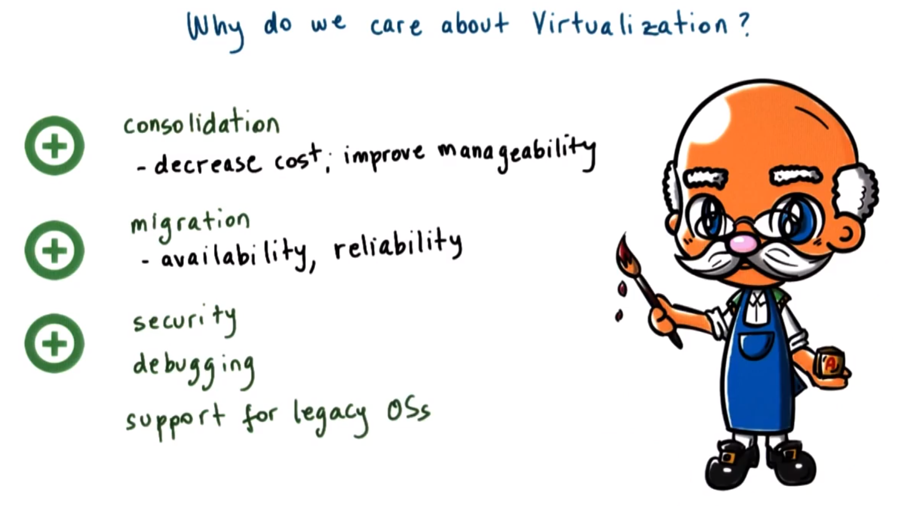

The **key benefits of Virtualization**, organized into five main areas:

* **Consolidation & Cost Efficiency:** Enables running multiple VMs (with their own OSs and applications) on a single physical platform. Using fewer physical machines reduces space requirements, administrative overhead, and power bills while running the same workloads—lowering costs and improving system manageability.
* **Hardware Decoupling, Availability & Reliability:** Encapsulating the OS and applications inside a VM decouples them from physical hardware, making it easy to **migrate**, **copy**, or **clone** workloads across physical hosts. This boosts **availability** (rapidly cloning VMs to handle load spikes) and **reliability** (migrating VMs off overheating or failing hardware nodes).
* **Fault & Security Containment:** Encapsulation isolates software bugs and malicious behavior strictly within the resources allocated to that individual VM, preventing failures or attacks from compromising the entire physical host.
* **Accelerated OS Research & Debugging:** Serves as a vital testbed for operating systems research, allowing developers to introduce new OS features inside a VM, observe behavior, and debug rapidly—bypassing the slow traditional cycle of physical hardware reboots and manual error-log searches.
* **Cost-Effective Legacy OS Support:** Eliminates the need to dedicate separate physical hardware to outdated operating systems required by legacy applications; instead, legacy OSs can be packaged as VMs and co-located alongside modern workloads on shared hardware.

## 6. Benefits of Virtualization Quiz 1 and Answers

If **virtualization** has been around since the 1960s, why has it not been used ubiquitously until relatively recently? (Select all that apply.)
  * Virtualization was not efficient
    * `DOES NOT APPLY`
  * Everyone used Microsoft Windows
    * `DOES NOT APPLY`
  * Mainframes were not ubiquitous
    * `APPLIES`
  * Other hardware was cheap
    * `APPLIES`

**Explanation**: The majority of companies historically did not necessarily run mainframe computers, but rather they ran servers based mostly on the x86 architecture. This arrangement was more affordable, and it was generally much simpler to add new pieces of hardware than to determine how to make multiple applications and multiple operating systems coexist on that *same* hardware platform. Therefore, this trend of simply buying/adding more machines in order to run a different kind of operating system to support different applications continued for several decades, up until recently.

## 7. Benefits of Virtualization Quiz 2 and Answers

If **virtualization** was not widely adopted in the past, then what changed? Why did we start to care more about virtualization? (Select all that apply.)
  * Servers were under-utilized
    * `APPLIES`
  * Datacenters were becoming too large
    * `APPLIES`
  * Companies had to hire more system administrators
    * `APPLIES`
  * Companies were paying high utility bills to run and cool servers
    * `APPLIES`

**Explanation**: In the process of following the approach of buying new hardware whenever there is a need to run a slightly different operating system or to support slightly different applications (cf. Section 6, Quiz 1), datacenters became too large. Simultaneously, some of the server were being severely under-utilized; in fact, on average, the utilization rates in datacenters were at a maximum of around 10-20%. Consequently, companies--now having to manage these large datacenters containing many machines--required the addition of more personnel (e.g., system administrators) to manage this complexity, as well as had to manage increasing operating costs (e.g., ensuring that the machines operated within a certain allowable temperature variability range). Cumulatively, these factors contributed to companies spending nearly 70% of their information technology (IT) budget on operating expenses (i.e., to the detriment of capital expenditures on new hardware, new software services, etc.). Therefore, it became apparent there was an importance/urgency in revisiting (previously "dormant") virtualization technology as a mechanism for consolidating these workloads onto fewer hardware resources that will be easier to manage and more cost-effective to operate.

## 8-9. Virtualization Models

### **8. Introduction**

TODO

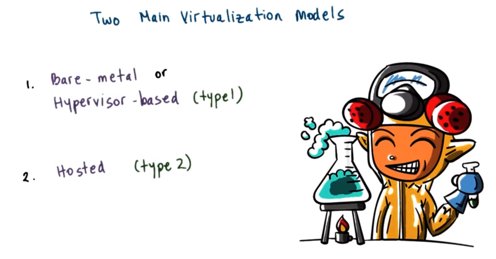

### **8. Bare Metal**

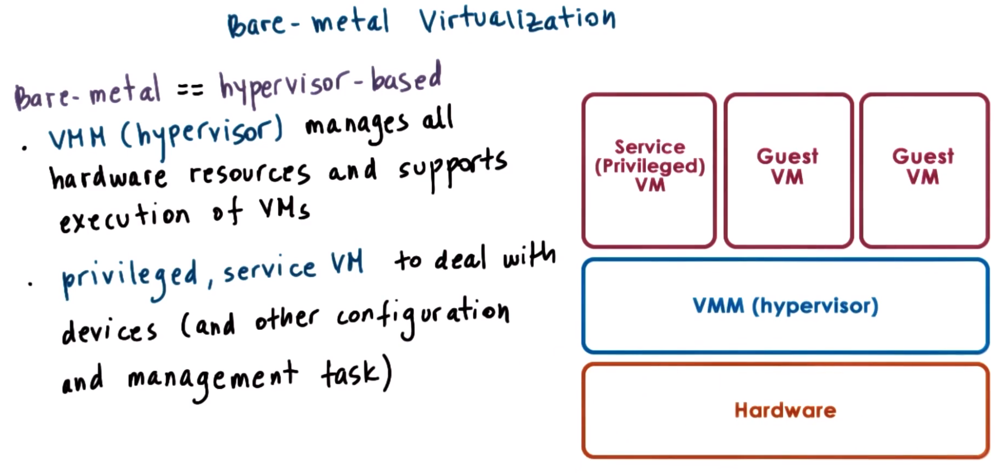

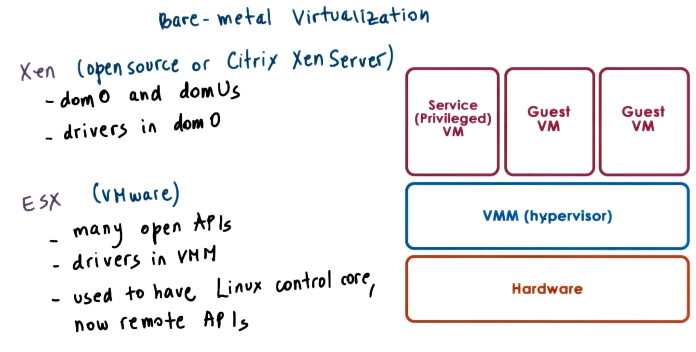

### Two Main Virtualization Models & Type Naming

  * Before describing the technical requirements for virtualization, review the **Two Main Virtualization Models**: **Bare-metal or Hypervisor-based** and **Hosted**.
  * They are also commonly referred to as **Type 1** (for the Hypervisor-based model) and **Type 2** (for the Hosted model) in virtualization solutions.

**Bare - metal == hyper visor -based**

  * **VMM (HYPERVISOR)**
  * The bare-metal model matches what was illustrated earlier: a Virtual Machine Monitor (VMM) or hypervisor manages physical resources and supports executing entire virtual machines.
  * **Device challenge:** One issue with this model is devices. Under this model, the hypervisor must manage all possible devices—meaning device manufacturers must provide device drivers not only for different operating systems, but also for the different hypervisors that exist.

**PRIVileged, service VM**
  * To illustrate how this is addressed, the hypervisor model typically integrates a special virtual machine, such as a **service VM** (or **privileged VM**).
  * It runs a standard operating system and holds full hardware privileges to access and perform any kind of hardware manipulation, just as if working directly on physical hardware.
  * This privileged/service VM runs all of the device drivers and controls how devices on the platform are used.
  * The service VM also runs management and configuration tasks, such as specifying exactly how the hypervisor shares resources across guest VMs.

### Implementations: Xen & VMware ESX

* This model is adopted by the **Xen** virtualization solution and by VMware's **ESX** hypervisor.
* **Xen Open source or Citrix Xen Server**
  * Applies to both the open-source version of Xen and the Citrix-supported version, **XenServer**.
  * VMs running in the virtualized environment are referred to as **domains**.
  * The privileged domain is called **dom 0**, and guest VMs are referred to as **domUs**.
  * **Xen** is the actual hypervisor, while all drivers run in the privileged domain, **dom 0**—so managing all devices involves executing drivers that are part of **dom 0**.

* *ESX vmware*
  * Because VMware and its hypervisors were first to market, VMware still owns the largest percentage of virtualized server cores, which run the **ESX** hypervisor.
  * Given this position, VMware can mandate from hardware vendors that they provide drivers for different devices included in the hypervisor.
  * This is less severe because it targets the server market space, where servers in data centers have fewer devices (and less device variety) than laptops, desktops, or client platforms in general.
  * To support a third-party developer community, VMware exports a number of **APIs**, helping both developers and users configure the exact policies enforced by the hypervisor.
  * **Architectural change:** In the past, the ESX architecture had a control core / core domain based on a regular operating system—specifically **Linux**—whereas **right now**, all configuration-related tasks are configured via **remote APIs**.

### **9. Hosted**

TODO

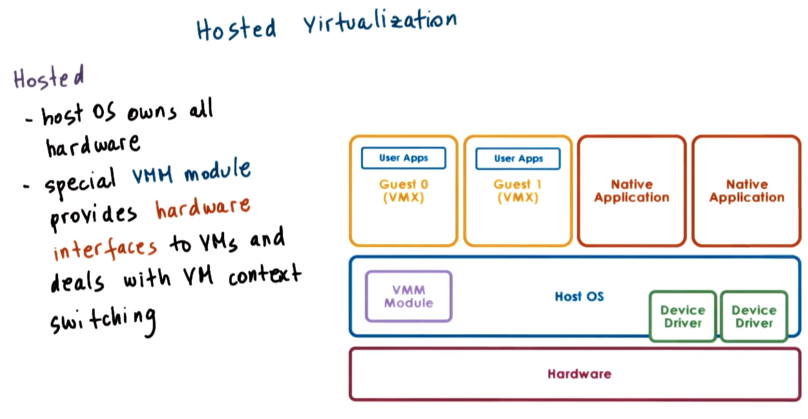

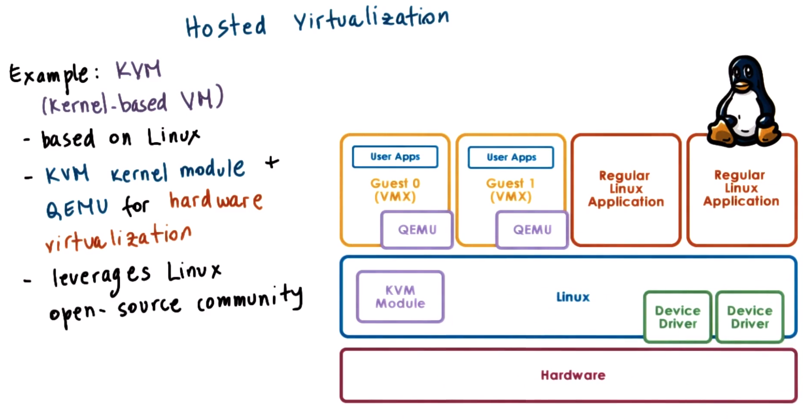

## 10. Bare Metal or Hosted Quiz and Answers

Classify the following **virtualization products** as **bare-metal/hypervisor-based** (`HV`) or **host-OS-based** (`OS`):
  * KVM
    * `OS`
      * ***N.B.*** With respect to KVM, the host operating system switches to a mode/module in order to assume a hypervisor-like role, whereby the rest of the operating system provides a secondary supporting role (i.e., akin to a privileged partition).
  * Fusion
    * `OS`
  * VirualBox
    * `OS`
  * VMware Player
    * `OS`
  * VMware ESX
    * `HV`
  * Citrix XenServer
    * `HV`
  * Microsoft Hyper-V
    * `HV`

## 11. Virtualization Requirements Quiz and Answers

In the following options, which are **virtualization requirements**? (Select all that apply.)
  * Present the virtual platform interface to the guest virtual machines
    * `APPLIES` - At the lowest level, the virtual machine monitor (VMM) must provide the guest virtual machines with a virtual platform interface to all of the hardware resources (e.g., the CPU, the memory, the devices, etc.).
  * Provide isolation across the guest virtual machines
    * `APPLIES` - The virtual machine monitor (VMM) must isolate the guest virtual machines from each other. This can be easily achieved by using similar mechanisms to those used by operating systems to provide isolation across the guest virtual machines (e.g., preemption, hardware support via the memory management unit (MMU) to perform fast validations and translations of memory references/addresses, etc.)
  * Protect the guest operating system from applications running in the virtual machine
    * `APPLIES` - Within the virtual machine, at the top-most level of the stack, the virtualization solution must continue to provide the ability to protect the guest operating system from faulty or malicious applications (e.g., it is undesirable for the entire guest operating system to crash if a single application crashes). To achieve this, it is necessary to have separate protection levels both for the applications as well as for the guest operating system (i.e., it is *not* permissible to run the guest operating system and the applications at the *same* protection level). Therefore, these expectations that exist when the guest operating system is executing natively on the physical platform must also be met in the virtualized environment as well.
  * Protect the virtual machine monitor (VMM) from the guest operating system
    * `APPLIES` - The virtualization solution must have mechanisms to protect the virtual machine monitor (VMM) from the guest operating system(s). It is undesirable for a single faulty or malicious guest operating system to bring down the hypervisor for the entire machine. Therefore, it is *not* permissible to have a solution wherein the guest operating system and the virtual machine monitor (VMM) run at the *same* protection level; instead, they must be separated.

## 12. Hardware Protection Levels

TODO

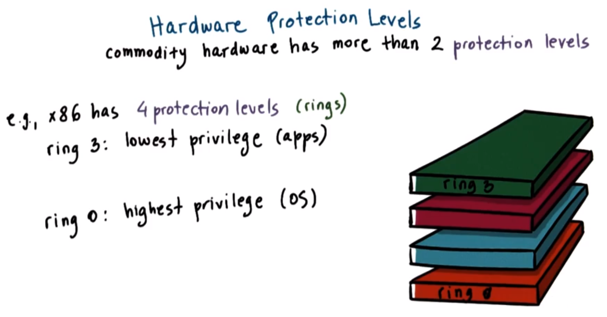

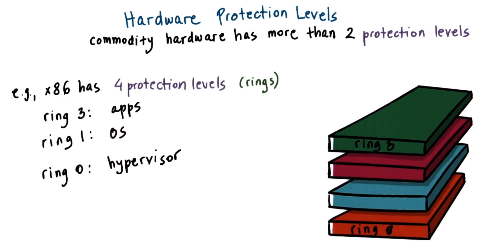

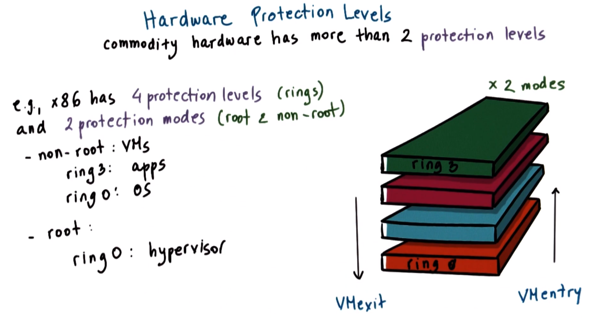

## 13. Processor Virtualization

TODO

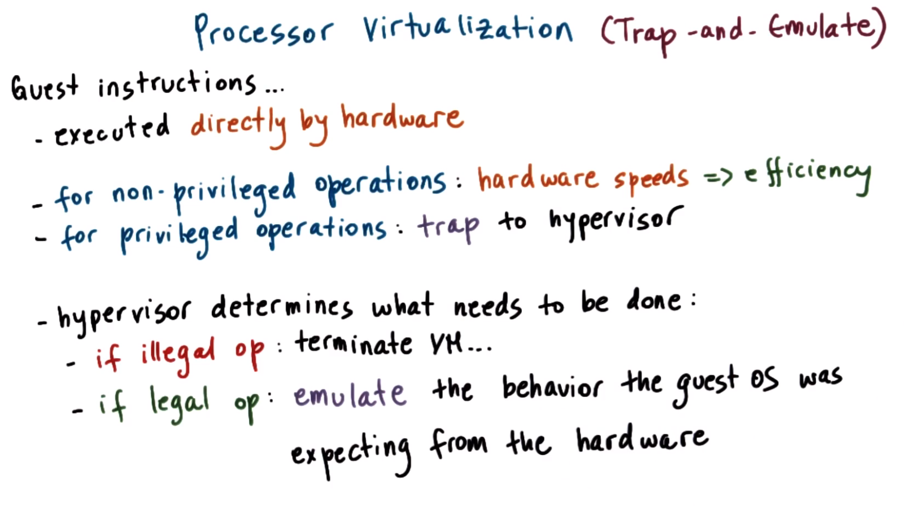

## 14. x86 Virtualization in the Past

### **Problems with Trap-and-Emulate**

TODO

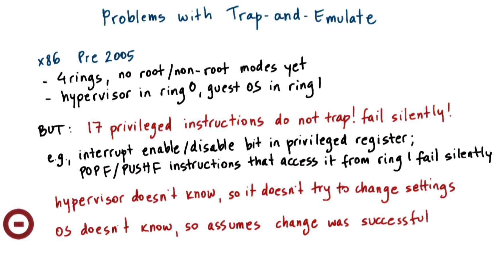

## 15. Problematic Instructions Quiz and Answers

In earlier x86 platforms, the CPU flag **privileged register** was accessed via the **instructions** `POPF` and `PUSHF` that ***failed silently*** if not called from **ring 0** (**hypervisor**). What do you think can occur as a result? (Select the correct option.)
  * The guest virtual machine could not request interrupts enabled
  * The guest virtual machine could not request interrupts disabled
  * The guest virtual machine could not determine the current state of the interrupts enabled/disabled bit
  * All of the above
    * `CORRECT` - To perform any of the indicated operations indicated in the other options, this requires access to the privileged register and requires execution of the corresponding instructions `POPF` and `PUSHF`. When these fail silently, the guest virtual machine assumes that the request completed, and may consequently interpret some other information that is on the stack incorrectly (i.e., as if it were information provided by the privileged register). Therefore, none of these operations will be performed successfully.

## 16. Binary Translation

TODO

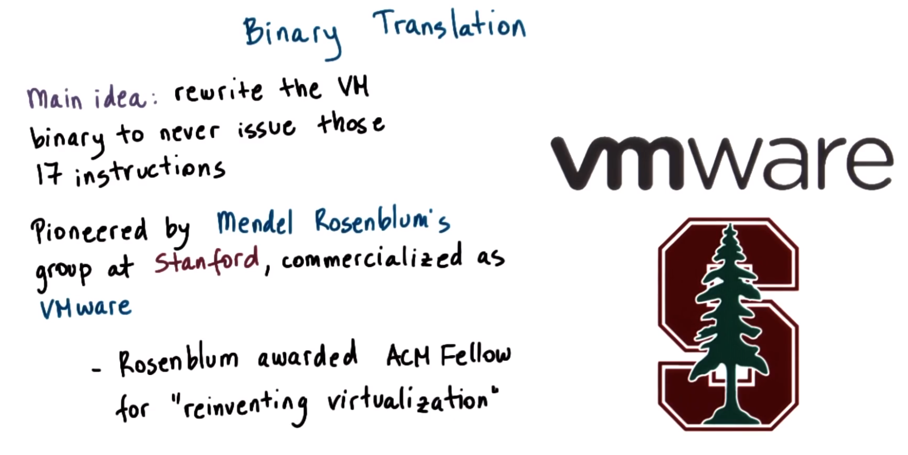

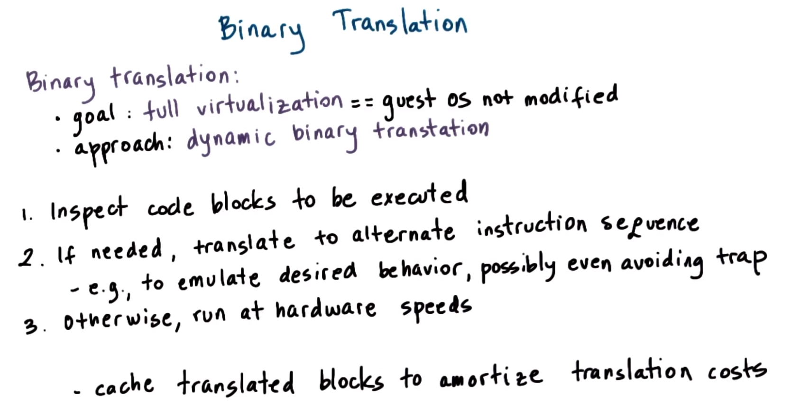

## 17. Paravirtualization

TODO

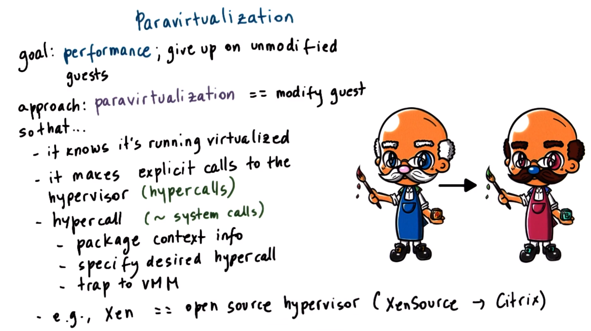

## 18. Binary Translation & Paravirtualization Quiz and Answers

Which of the following will cause a **trap** and consequent **exit** from the virtual machine to the hypervisor for ***both*** binary-translation and paravirtualized virtual machines? (Select one.)
  * Access of a page that is swapped
    * `CORRECT` - If the page is not present, it will be the hardware memory management unit (MMU) that will fail, resulting in passing of control to the hypervisor (i.e., regardless of the virtualization approach).
  * `INCORRECT` - Update to a page table entry
    * This is not always true; rather, it depends on whether or not the operating system has write permissions for the page tables that it uses.  
      * ***N.B.*** The next section will describe handling this situation.

## 19-20. Memory Virtualization

### **19

TODO

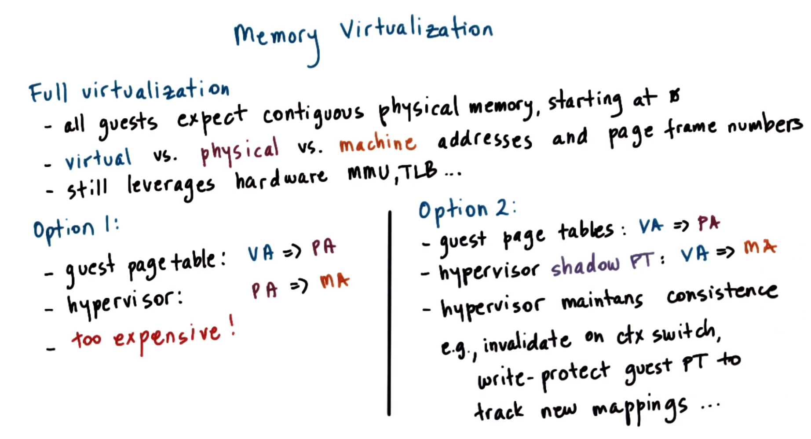

### **20. Paravirtualized**

TODO

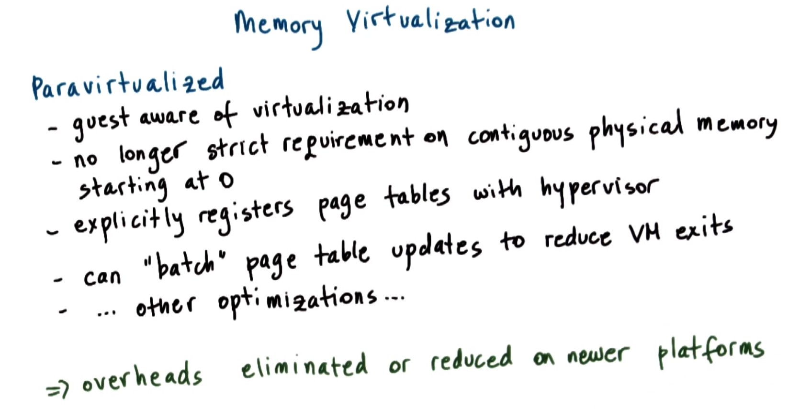

## 21-24. Device Virtualization

### **21. Introduction**

TODO

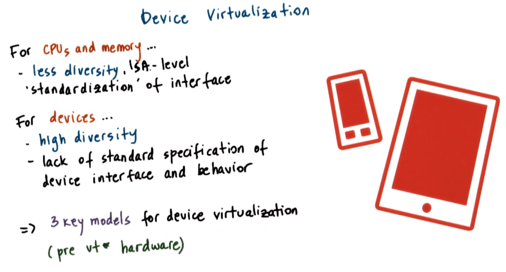

### **22. Passthrough Model**

TODO

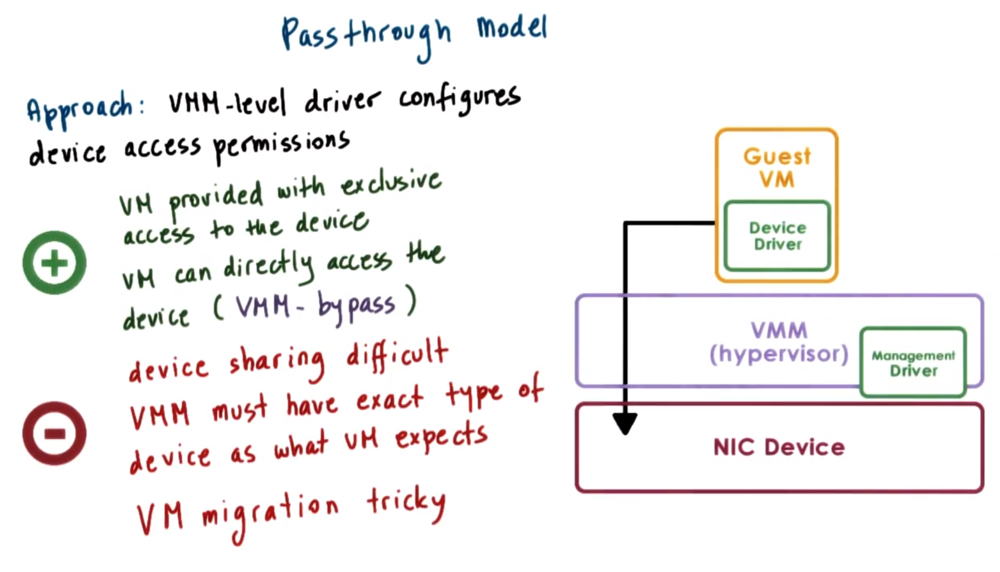

### **23. Hypervisor-Direct Model**

TODO

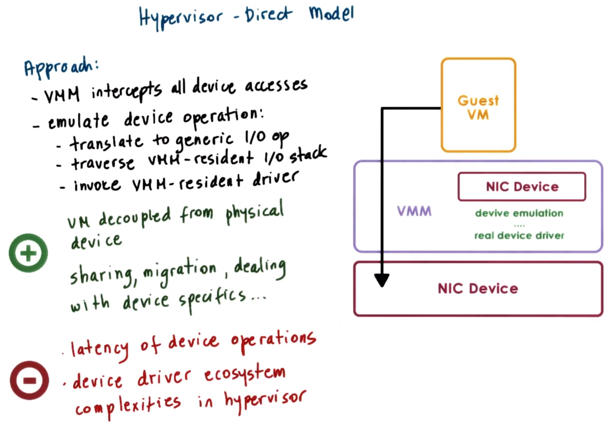

### **24. Split-Device-Driver Model**

TODO

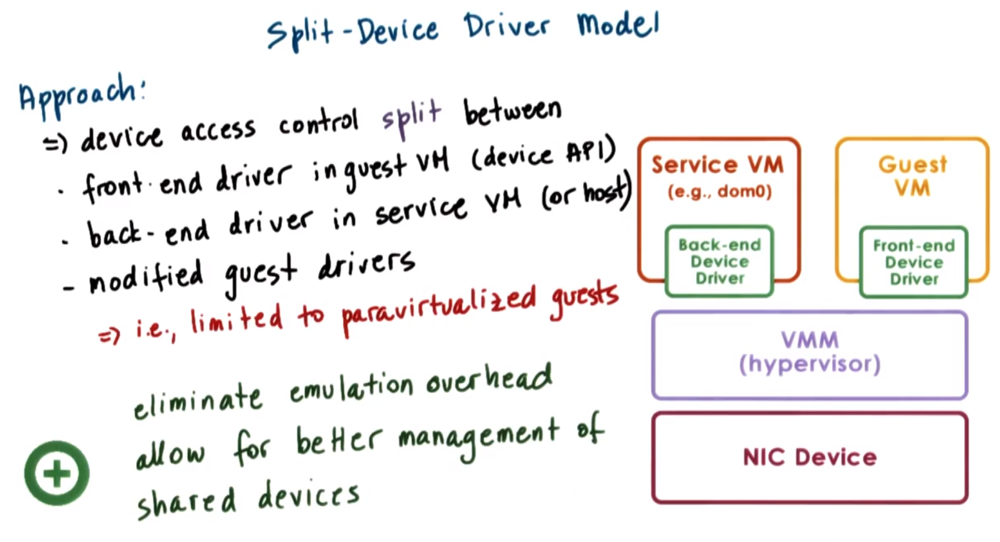

## 25. Hardware Virtualization

TODO

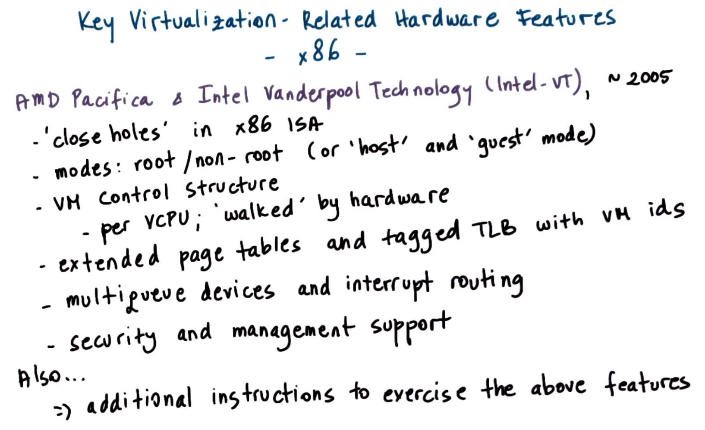

## 26. Hardware Virtualization Quiz and Answers

With hardware support for virtualization, guest virtual machines (VMs) can run unmodified and can have access to the underlying devices. Given this, do you think that the split-device driver model is still relevant?
  * `YES` - With the split-device driver model, all of the requests for device access are consolidated to the surface virtual machine (VM), which can make better decisions and can enforce stronger policies in terms of how the devices are shared (i.e., without otherwise relying on specific support for the desired sharing behavior on the actual physical devices).

## 27. x86 Virtualization Technology Revolution

TODO

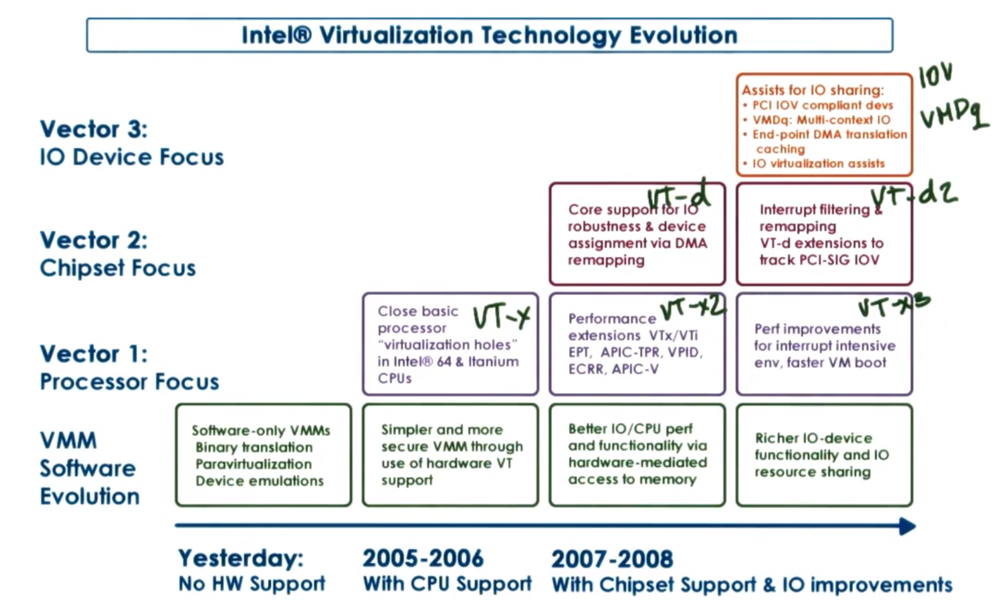

## 28. Lesson Summary

TODO
